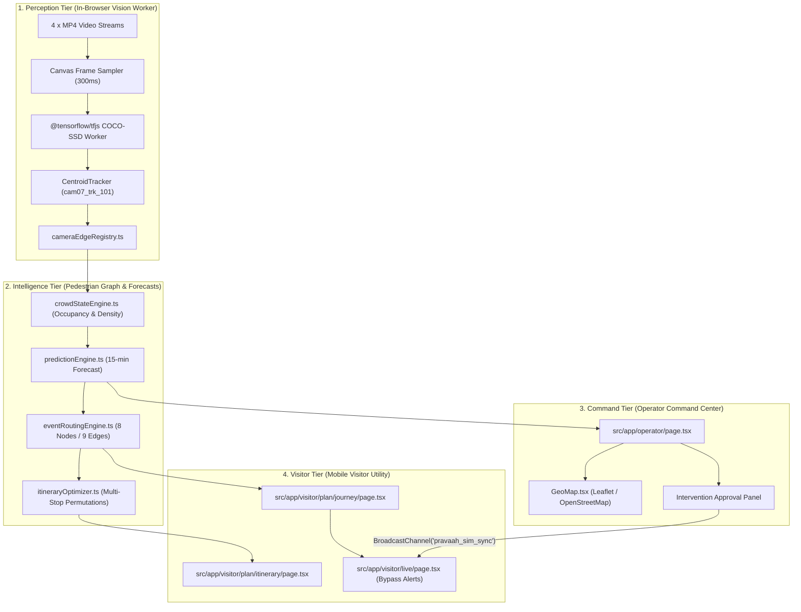

# Pravaah — Mega-Event Hospitality & Destination Intelligence Orchestrator

[](https://nextjs.org/)
[](https://react.dev/)
[](https://www.typescriptlang.org/)
[](https://www.tensorflow.org/js)
[](https://tailwindcss.com/)

> **Pravaah** connects real-time computer vision crowd perception, event-aware pedestrian graph routing, multi-stop itinerary optimization, product design strategy, production budget modeling, and dual-surface state synchronization into one unified destination management platform for million-scale mega-events (e.g., Maha Kumbh Parv, 1.25M+ visitors).

---

## 🚀 Quick Links for Hackathon Reviewers & Judges

- 🌐 **Live Vercel Application**: [https://mega-event-orchestration-prototype.vercel.app/](https://mega-event-orchestration-prototype.vercel.app/)
- 📖 **Inside Pravaah — Technical Explainer & Architecture Dossier**: [https://mega-event-orchestration-prototype.vercel.app/inside](https://mega-event-orchestration-prototype.vercel.app/inside)
- 💻 **GitHub Source Repository**: [https://github.com/Rishi7468/mega-event-orchestration-prototype](https://github.com/Rishi7468/mega-event-orchestration-prototype)

### What Reviewers Will Find in the `/inside` Technical Dossier
The `/inside` page serves as a comprehensive, evidence-backed engineering report covering:
1. **Product Design Strategy & User Personas**: Persona-based user journeys (Visitor, Operator, Field Response, Planner) and UX decisions.
2. **System Architecture & Data Flow**: Multi-tier architecture diagrams, state sync mechanisms, and bidirectional data flow models.
3. **In-Browser Computer Vision Pipeline**: `@tensorflow/tfjs` + COCO-SSD (`lite_mobilenet_v2`) frame sampling, pixel centroid tracking, and zero-video-upload privacy guarantees.
4. **Pedestrian Graph & Routing Math**: 8-node / 9-edge pedestrian network, Haversine polyline travel times, dynamic crowd penalties, and 13 candidate route pools.
5. **Multi-Stop Itinerary Optimizer**: Landmark permutation optimizer under a user time budget considering live queue wait times and visit dwell times.
6. **Worked Scenario Trace**: Step-by-step trace of a 15-minute congestion spike, operator intervention approval, and automatic visitor rerouting.
7. **Production Cost & Scaling Model**: Formula-driven, interactive INR budget calculator for 4, 25, or 100 camera deployments.
8. **Current Limitations Audit & 5-Stage Roadmap**: Transparent codebase audit distinguishing in-browser prototype baseline from proposed PostgreSQL/PostGIS & YOLOv11 production targets.
9. **Reviewer Technical FAQ**: Source-backed answers to 15+ technical evaluation questions.

---

## Table of Contents

- [Problem and Solution](#problem-and-solution)
- [Key Features](#key-features)
- [Demo Walkthrough](#demo-walkthrough)
- [System Architecture](#system-architecture)
- [Data, Simulation, and Provenance](#data-simulation-and-provenance)
- [Maps and Camera Intelligence](#maps-and-camera-intelligence)
- [Running Locally](#running-locally)
- [Deployment](#deployment)
- [Project Structure](#project-structure)
- [Limitations and Future Scope](#limitations-and-future-scope)
- [Hackathon Context](#hackathon-context)

---

## Problem and Solution

### The Mega-Event Overcrowding Challenge

During million-scale mega-events (e.g., Maha Kumbh Parv), vehicular traffic navigation systems break down because pedestrian density, venue gate queues, and corridor throughput change minute-by-minute. A corridor or gate that is completely clear at 8:00 AM can reach severe stampede risk by 8:30 AM due to uncoordinated visitor arrivals.

- **Rapid Demand Spikes**: Bathing ghats, temples, and transit hubs experience rapid surge spikes that manual spot counting cannot monitor in time.
- **Vehicular Map Mismatch**: Standard GPS navigation APIs calculate vehicular highway speed rather than pedestrian bottlenecking and precinct queue delays.
- **Uncoordinated Visitor Choices**: Unaware of live gate queues, thousands of arriving visitors head to the same entry gate simultaneously.

### The Pravaah Closed-Loop Solution

Pravaah closes the gap between **visitor trip decisions** (when to arrive, which gate to enter, how to route around crowd spikes) and **operator command decisions** (monitoring sector occupancy, receiving early 15-minute warnings, approving gate diversions) by maintaining a single, shared simulation state loop:

```text
Sense (Camera Vision / Telemetry) → Predict (15-min Forecast) → Recommend (Adaptive Route / Gate) → Decide (Human Operator / Visitor Accept) → Outcome (Measured Before/After)
```

Both the **Mobile Visitor Utility** (`/visitor`) and the **Desktop Operator Command Center** (`/operator`) consume the same underlying intelligence engine—when an operator approves a gate diversion, visitor route recommendations adjust automatically across connected clients.

---

## Key Features

- **Dual-Surface Role-Optimized Interfaces**: Mobile-first visitor journey planner (`/visitor`) and desktop-first command center dashboard (`/operator`).
- **In-Browser Multi-Camera Perception**: Background canvas sampling running `@tensorflow/tfjs` + COCO-SSD (`lite_mobilenet_v2`) across 4 camera feeds with camera-isolated centroid tracking (`cam07_trk_101`).
- **8-Node / 9-Edge Pedestrian Graph**: Polyline Haversine distance, speed scaling (70 m/min), dynamic crowd penalties, and 13 zone-pair candidate route pools (`ROUTE_CANDIDATES_BY_PAIR`).
- **15-Minute Predictive Risk Engine**: Deterministic net flow rate extrapolation `(netFlow = incoming - outgoing)` and time-to-critical threshold calculations.
- **Multi-Stop Permutation Optimizer**: Evaluates landmark permutations under a user time budget considering queue wait times and dwell times.
- **Dual-Surface State Synchronization**: React Zustand stores connected via browser `BroadcastChannel("pravaah_sim_sync")` and Server-Sent Events (`/api/simulation/stream`).
- **Interactive Production Cost Calculator**: Dynamic slider calculator evaluating hardware procurement, cloud GPU compute, bandwidth, and staffing in INR (₹).
- **Comprehensive Technical Dossier (`/inside`)**: 17 structured technical sections, 5 interactive visual diagrams, worked scenario trace, budget model, and reviewer FAQ.

---

## Demo Walkthrough

### 1. Visitor Experience (`/visitor`)
1. **Destination Intent** (`/visitor/destination`): Select event origin sector, arrival window, and destination landmark.
2. **Event-Aware Route Recommendation** (`/visitor/plan/journey`): Evaluates pedestrian graph candidate pools and recommends optimal gate (e.g. Gate B over congested Gate A).
3. **Multi-Stop Itinerary Optimizer** (`/visitor/plan/itinerary`): Permutates landmark visits under user time budget.
4. **Live Navigation & Bypass Alerts** (`/visitor/live`): Displays turn-by-turn guidance and dynamic corridor bypass prompts during live spikes.

### 2. Operator Command Center (`/operator`)
1. **4-Sector Capacity Monitoring** (`/operator`): Real-time occupancy gauges, Leaflet venue map, and active phase controls.
2. **Multi-Camera Vision Perception** (`/operator/crowd`): Monitor 4 live camera feeds, inspect TF.js bounding box counts, and view camera-isolated track IDs.
3. **Capacity Analytics** (`/operator/demand`): Sector occupancy trends, net flow accumulation rates, and historical comparison charts.
4. **Intervention Approval Panel** (`/operator/interventions`): Human-in-the-loop recommendation approval panel for gate diversions and shuttle dispatches.

### 3. Technical Explainer Dossier (`/inside`)
- Interactive product strategy, computer vision pipeline, graph math, cost calculator, limitations matrix, and reviewer FAQ.

---

## System Architecture



---

## Data, Simulation, and Provenance

Pravaah explicitly categorizes all operational data using provenance badges:

| Provenance Badge | Meaning & Source | Application Implementation |
| :--- | :--- | :--- |
| **`REAL_VIDEO`** | Live Vision Telemetry | Output of in-browser TF.js COCO-SSD object perception worker on MP4 camera streams. |
| **`SIMULATED`** | Synthetic Scenario State | Synthetic demand spikes and phase transitions authored in `simulationStore.ts`. |
| **`DERIVED`** | Algorithmic Result | Edge congestion, 15-minute predictive risk forecasts, and route cost calculations. |
| **`STATIC`** | Fixed Geography | Fixed venue coordinates, sector boundaries, gate capacities, and landmark metadata in `src/data/`. |

### Client State & Server Transport Synchronization
- **`simulationStore.ts`**: Venue operational state (sector pressures, active interventions). Saved in `localStorage` under key `pravaah_simulation_store`.
- **`visitorStore.ts`**: Visitor selections (origin, selected gate, itinerary). Isolated to active tab memory.
- **`eventAuthoringStore.ts`**: Spatial event authoring models (zones, gates, route polylines). Saved in `localStorage`.
- **Synchronization Bridge**: `TransportSyncBridge.tsx` connects Zustand stores via browser `BroadcastChannel("pravaah_sim_sync")` for same-browser tabs and `/api/simulation/stream` (Server-Sent Events) for cross-device updates.

---

## Maps and Camera Intelligence

### Interactive Map Integration
- Built using **Leaflet 1.9.4** and OpenStreetMap vector tiles without requiring external API keys.
- Renders sector polygon overlays, gate markers, landmark pins, and color-coded pedestrian corridor polylines.

### Computer Vision Pipeline Mechanics
- **Frame Sampler**: Samples background canvas frames every 300ms (`PERCEPTION_FPS: 3`).
- **Model Variant**: `@tensorflow-models/coco-ssd` loaded with `base: "lite_mobilenet_v2"`.
- **Centroid Tracker**: Persists anonymous track IDs across frames using pixel distance and IoU matching with camera-isolated prefixes (`cam07_trk_101`).
- **Privacy Guarantee**: Canvas frame sampling executes strictly inside client browser RAM. No video frames, camera snapshots, or imagery leave the browser or transmit over external networks.
- **Schema Tagging Note**: Telemetry payloads feature a field `model: "yolo11"`. This serves as an API schema label for proposed enterprise perception server compatibility; in-browser client detection is performed by COCO-SSD (`lite_mobilenet_v2`).

---

## Running Locally

### Prerequisites
- Node.js 18.0 or higher
- npm 9.0 or higher

### Installation & Execution

1. **Clone the repository**:
   ```bash
   git clone https://github.com/Rishi7468/mega-event-orchestration-prototype.git
   cd mega-event-orchestration-prototype
   ```

2. **Install dependencies**:
   ```bash
   npm install
   ```

3. **Start local development server**:
   ```bash
   npm run dev
   ```

4. **Access local application routes**:
   - Landing Page: `http://localhost:3000`
   - Technical Explainer Dossier: `http://localhost:3000/inside`
   - Command Center: `http://localhost:3000/operator`
   - Visitor Utility: `http://localhost:3000/visitor`

### Verification & Validation Commands

```bash
# Typecheck TypeScript files (Must pass with 0 errors)
npx tsc --noEmit

# Run ESLint checks
npm run lint

# Create optimized Next.js static production build
npm run build
```

---

## Deployment

### Live Production Deployment
- **Vercel Live URL**: [https://mega-event-orchestration-prototype.vercel.app/](https://mega-event-orchestration-prototype.vercel.app/)
- **Technical Dossier Route**: [https://mega-event-orchestration-prototype.vercel.app/inside](https://mega-event-orchestration-prototype.vercel.app/inside)
- **Operator Command Center Route**: [https://mega-event-orchestration-prototype.vercel.app/operator](https://mega-event-orchestration-prototype.vercel.app/operator)
- **Visitor Portal Route**: [https://mega-event-orchestration-prototype.vercel.app/visitor](https://mega-event-orchestration-prototype.vercel.app/visitor)

*Deployment Note*: The application is deployed on Vercel as a Next.js App Router application with dynamic Server-Sent Event stream endpoints (`/api/simulation/stream`).

---

## Project Structure

```text
mega-event-orchestration-prototype/
├── public/
│   └── media/cameras/          # MP4 camera feeds (camera-01.mp4 .. camera-04.mp4)
├── src/
│   ├── app/
│   │   ├── api/                # Next.js App Router SSE routes (/api/simulation/stream)
│   │   ├── inside/             # Technical Explainer & Dossier (/inside)
│   │   ├── operator/           # Command Center surface (/operator, /operator/crowd)
│   │   ├── visitor/            # Visitor app surface (/visitor, /visitor/plan)
│   │   ├── globals.css         # Tailwind CSS styling & design tokens
│   │   ├── layout.tsx          # Root application layout & metadata
│   │   └── page.tsx            # Public landing page & role selector
│   ├── components/
│   │   ├── camera/             # Multi-camera video analyzer & preview canvas
│   │   ├── explainer/          # Dossier sections, cost calculator, diagrams, FAQ
│   │   ├── map/                # Leaflet GeoMap & polyline routing overlays
│   │   ├── operator/           # Command center panels & intervention controls
│   │   ├── shared/             # TransportSyncBridge & cross-tab sync components
│   │   └── visitor/            # Visitor navigation cards & bypass banners
│   ├── data/                   # Canonical geography, sector & camera registries
│   ├── lib/
│   │   ├── adapters/           # Visitor data adapters & raw telemetry schemas
│   │   ├── cv/                 # VideoPerceptionEngine, CentroidTracker, cameraEdgeRegistry
│   │   ├── graph/              # 8-node / 9-edge pedestrian graph network
│   │   ├── intelligence/       # crowdStateEngine, predictionEngine, eventRoutingEngine
│   │   └── journey/            # itineraryOptimizer & journey builder functions
│   └── store/                  # Zustand stores (simulationStore, visitorStore, etc.)
├── package.json                # Dependencies & package scripts
├── next.config.ts              # Next.js configuration
├── tsconfig.json               # TypeScript configuration
└── README.md                   # System documentation & reviewer guide
```

---

## Limitations and Future Scope

### Verified Prototype Limitations Audit
- **Backend & Database**: Prototype uses in-browser Zustand state stores and `localStorage`. There is no PostgreSQL, PostGIS, or Redis database in the prototype baseline. Server routes in `/api/simulation/` run in volatile Node memory.
- **Vision Model Sensitivity**: In-browser detector uses pretrained COCO-SSD `lite_mobilenet_v2` trained on MS-COCO. It is sensitive to umbrella occlusion, extreme camera pitch, and heavy rain, and has not been benchmarked on mega-event ground-truth datasets.
- **Authentication & RBAC**: Prototype routes are open for demonstration; production requires OAuth2 / OIDC authentication with fine-grained Role-Based Access Control (RBAC).

### Proposed Target Production Architecture
- **RTSP / WebRTC Ingestion**: MediaMTX + FFmpeg hardware decoding for live CCTV camera streams.
- **Server GPU Microservices**: YOLOv11 / TensorRT with DeepStream running on dedicated GPU worker instances @ 30 FPS.
- **PostgreSQL / PostGIS**: Persistent geospatial database storing venue geometry, sector polygons, and historic incident logs.
- **Redis WebSocket Gateway**: Multi-region WebSocket cluster for sub-50ms cross-device state synchronization.

### 5-Stage Evolutionary Production Roadmap
1. **Stage 1 (Mo 0-3)**: Prototype Hardening & Labeled Video Ground-Truth Benchmark Harness.
2. **Stage 2 (Mo 3-6)**: Centralized Application Backend & PostgreSQL/PostGIS Spatial Database.
3. **Stage 3 (Mo 6-12)**: Enterprise Redis-backed WebSocket Real-Time Multi-Operator Gateway.
4. **Stage 4 (Mo 12-18)**: Server-Side RTSP Video Intelligence Microservices (YOLOv11/DeepStream).
5. **Stage 5 (Mo 18-24)**: Production Security Audit, Privacy Compliance & 72-Hour Live Venue Pilot.

---

## Hackathon Context

### Event & Problem Context
Developed as a hackathon submission for **Mega-Event Hospitality & Destination Intelligence Orchestration**. Designed specifically for high-density pedestrian events (e.g. Maha Kumbh Parv, 1.25M+ visitors) where vehicular navigation breaks down and dynamic pedestrian crowd routing is vital for public safety.

### Responsible Engineering Disclaimers
- **Decision-Support Prototype**: Pravaah is an engineering decision-support prototype and simulation model. It does not replace physical police emergency services, provide legally binding safety guarantees, or eliminate physical crowd risk without human operator dispatch.
- **Privacy Assurance**: All video perception operates in client browser volatile RAM. No facial recognition or identity tracking is performed.
